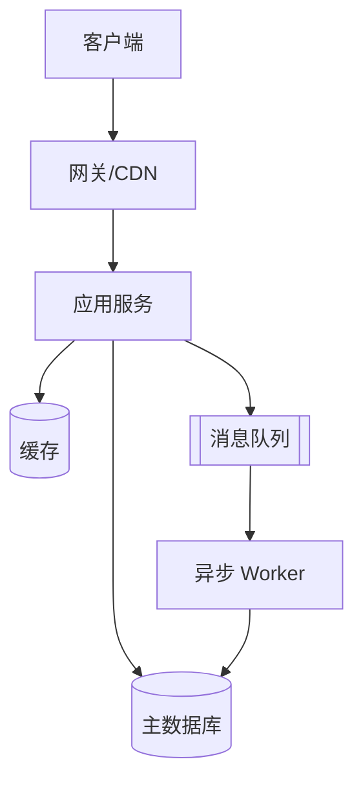
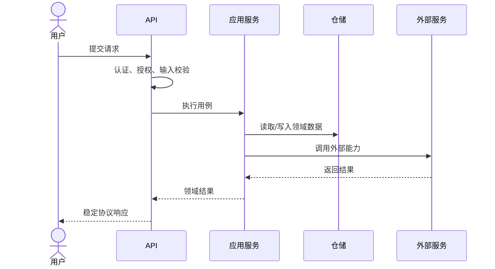

# {{PROJECT_NAME}} 架构说明

状态：`{{草案 / 已批准 / 已实现}}`  
负责人：`{{OWNER_OR_TEAM}}`  
最后核验：`{{YYYY-MM-DD}}`  
适用版本：`{{VERSION_OR_COMMIT}}`

本文是系统架构的权威入口，描述稳定的系统边界、组件职责、依赖规则、核心数据流和运行拓扑。具体功能需求见 `docs/product-specs/`，单项方案和取舍见 `docs/design-docs/`，实施进度见 `docs/exec-plans/`。

## 1. 项目概述

### 1.1 背景与目标

`{{说明业务背景、用户问题、系统要实现的核心结果。控制在三至五段。}}`

### 1.2 架构目标

- `{{例如：核心写入路径在正常负载下 P95 小于 300 ms}}`
- `{{例如：单个下游故障不影响只读核心能力}}`
- `{{例如：领域模块可独立测试，基础设施可替换}}`
- `{{例如：所有敏感操作可审计}}`

### 1.3 非目标

- `{{当前明确不解决的问题}}`
- `{{有意不支持的规模、平台或兼容范围}}`
- `{{推迟到后续阶段的能力}}`

### 1.4 关键约束

- 业务约束：`{{监管、成本、上线时间、地域等}}`
- 技术约束：`{{运行时、云平台、旧系统、协议等}}`
- 数据约束：`{{一致性、驻留、保留期、隐私级别等}}`

## 2. 系统上下文

### 2.1 参与者与外部系统

| 参与者/系统 | 关系 | 交换的数据 | 信任级别 | 失败影响 |
| --- | --- | --- | --- | --- |
| `{{终端用户}}` | `{{通过 Web/API 使用}}` | `{{请求、业务数据}}` | 不可信输入 | `{{影响}}` |
| `{{身份提供方}}` | `{{认证}}` | `{{Token/身份声明}}` | 有条件信任 | `{{无法登录}}` |
| `{{第三方服务}}` | `{{能力说明}}` | `{{数据类型}}` | 外部依赖 | `{{降级/中断}}` |

### 2.2 上下文图

复制后将节点替换为真实名称；图中只展示系统边界和外部交互。

```mermaid
flowchart LR
    User[用户] -->|HTTPS| System[{{PROJECT_NAME}}]
    Admin[运营/管理员] -->|管理操作| System
    System -->|认证| IdP[身份提供方]
    System -->|调用| External[第三方服务]
    System -->|读写| Store[(受管数据存储)]
```

## 3. 总体架构

### 3.1 架构风格

本项目采用 `{{模块化单体 / 分层架构 / 六边形架构 / 事件驱动 / 微服务}}`。选择原因：

1. `{{它如何满足当前规模和团队协作方式}}`
2. `{{相比备选方案减少了什么复杂度}}`
3. `{{未来在什么明确条件下需要重新评估}}`

### 3.2 容器/部署单元

| 单元 | 职责 | 技术 | 对外接口 | 数据所有权 | 扩缩容方式 |
| --- | --- | --- | --- | --- | --- |
| `{{web-app}}` | `{{用户界面}}` | `{{技术栈}}` | `{{HTTPS}}` | 无 | `{{静态/CDN}}` |
| `{{api-service}}` | `{{用例编排和 API}}` | `{{技术栈}}` | `{{REST/gRPC}}` | `{{领域数据}}` | `{{水平扩展}}` |
| `{{worker}}` | `{{异步任务}}` | `{{技术栈}}` | `{{消息协议}}` | `{{任务状态}}` | `{{按队列深度}}` |



### 3.3 源码模块

| 模块 | 职责 | 允许依赖 | 禁止依赖 | 负责人 |
| --- | --- | --- | --- | --- |
| `{{domain}}` | 核心业务规则和实体 | 标准库、领域接口 | Web、数据库 SDK | `{{owner}}` |
| `{{application}}` | 用例编排、事务边界 | domain | 具体 UI | `{{owner}}` |
| `{{adapters}}` | API、数据库和第三方适配 | application、domain | 其他适配器内部 | `{{owner}}` |
| `{{bootstrap}}` | 依赖装配和进程启动 | 所有公开装配点 | 业务规则实现 | `{{owner}}` |

推荐依赖方向：

```text
外部输入 -> 接口适配层 -> 应用层 -> 领域层
基础设施适配层 ---------> 应用/领域定义的端口
```

领域层不得反向依赖框架、数据库或传输协议。跨模块协作只能通过公开接口、领域事件或明确的应用服务完成。

## 4. 核心业务流程

### 4.1 `{{核心用例名称}}`

前置条件：`{{身份、权限和状态要求}}`  
成功结果：`{{持久状态和用户可见结果}}`  
失败语义：`{{错误码、补偿或重试行为}}`



补充说明：`{{事务边界、幂等键、一致性、超时、重试和补偿策略}}`

## 5. 数据架构

### 5.1 数据所有权

- 每类核心数据必须有唯一写入责任模块。
- 其他模块不得绕过所有者直接修改其表或存储。
- 跨模块读取优先通过公开查询接口；确需共享只读模型时必须记录一致性和演进责任。

| 数据实体 | 所有者 | 存储 | 分类 | 保留期 | 一致性要求 |
| --- | --- | --- | --- | --- | --- |
| `{{User}}` | `{{identity}}` | `{{database/table}}` | `{{内部/敏感}}` | `{{期限}}` | `{{强/最终}}` |
| `{{Order}}` | `{{order}}` | `{{database/table}}` | `{{内部}}` | `{{期限}}` | `{{强一致}}` |

### 5.2 Schema 与迁移

- Schema 权威源：`{{migration_directory_or_schema_source}}`。
- 生成快照：`docs/generated/db-schema.md`，通过 `{{SCHEMA_GENERATE_COMMAND}}` 更新。
- 迁移必须可重复、可观测，并优先兼容滚动部署。
- 破坏性变更采用“扩展—迁移—收缩”：先新增兼容结构，再迁移读写和数据，最后删除旧结构。
- 生产迁移必须说明锁表风险、耗时估算、验证方式和回滚/前滚方案。

### 5.3 缓存

`{{缓存哪些数据、键格式、TTL、失效方式、击穿/雪崩防护，以及缓存故障时的行为。若不使用缓存，写明原因。}}`

## 6. 接口与集成

### 6.1 API 规则

- 契约源：`{{OpenAPI/Protobuf/GraphQL schema path}}`。
- 版本策略：`{{URL/Header/Schema evolution}}`。
- 错误模型：`{{稳定错误码、用户消息、追踪 ID}}`。
- 分页、排序、过滤和幂等规则：`{{规则}}`。
- 所有边界执行认证、授权、限流、输入校验和输出编码。

### 6.2 事件与异步任务

| 事件/任务 | 生产者 | 消费者 | 投递语义 | 幂等方式 | 失败处理 |
| --- | --- | --- | --- | --- | --- |
| `{{EventName}}` | `{{producer}}` | `{{consumer}}` | `{{至少一次}}` | `{{eventId}}` | `{{重试+死信}}` |

- 事件是已经发生的事实，使用过去时命名。
- 消费者必须假设消息会重复、延迟或乱序。
- Schema 变更必须向后兼容，并明确版本和废弃窗口。
- 消息重试必须有上限；不可恢复错误进入死信队列并触发告警。

### 6.3 外部依赖

| 依赖 | 用途 | 超时 | 重试 | 降级 | 数据风险 |
| --- | --- | --- | --- | --- | --- |
| `{{SERVICE}}` | `{{PURPOSE}}` | `{{TIMEOUT}}` | `{{POLICY}}` | `{{FALLBACK}}` | `{{DATA_CLASS}}` |

## 7. 横切关注点

### 7.1 身份与安全

- 信任边界：`{{浏览器、网关、服务、数据层之间的边界}}`。
- 身份认证：`{{机制和会话生命周期}}`。
- 权限模型：`{{RBAC/ABAC/ACL}}`，默认拒绝，服务端强制执行。
- 秘密管理：`{{秘密管理服务和轮换方式}}`。
- 数据保护：`{{传输加密、静态加密、脱敏和审计}}`。

完整要求见 [docs/SECURITY.md](docs/SECURITY.md)。

### 7.2 可观测性

- 日志：结构化事件，包含 `traceId`/`requestId`，不含秘密和个人敏感数据。
- 指标：至少覆盖请求量、错误率、延迟、饱和度及核心业务结果。
- 追踪：跨进程传播上下文，采样策略为 `{{SAMPLING_POLICY}}`。
- 告警：基于用户影响和 SLO，避免只对底层瞬时信号告警。

### 7.3 配置

- 配置按 `默认值 < 环境配置 < 秘密注入` 分层，优先级必须明确。
- 启动时校验必要配置，非法或缺失时尽早失败。
- 环境差异只能由配置表达，不能维护不同分支的业务代码。

### 7.4 性能与容量

| 指标 | 当前基线 | 目标/上限 | 验证方式 |
| --- | --- | --- | --- |
| 峰值吞吐 | `{{VALUE}}` | `{{VALUE}}` | `{{LOAD_TEST}}` |
| API P95 延迟 | `{{VALUE}}` | `{{VALUE}}` | `{{APM}}` |
| 数据量 | `{{VALUE}}` | `{{VALUE}}` | `{{CAPACITY_MODEL}}` |
| 并发任务 | `{{VALUE}}` | `{{VALUE}}` | `{{QUEUE_METRIC}}` |

### 7.5 请求与租户上下文隔离

本节仅在项目存在用户会话、租户、组织或后台任务时适用；不适用时写明原因。

- 每个请求的身份、租户、权限和追踪上下文必须由可信入口建立，不能直接信任客户端声明的 `tenantId` 或角色。
- 应用服务只接收本次请求明确传入的上下文；不得通过可变全局变量、进程单例或复用线程中的残留状态获取当前用户。
- 数据库查询、缓存键、对象存储路径、搜索索引和消息事件必须在必要时包含租户或组织隔离维度，并在服务端验证所有权。
- 异步任务要携带经过签名或服务端构造的最小必要上下文；任务执行完毕必须清理线程本地或请求局部状态。
- 测试必须覆盖两个不同用户/租户连续和并发访问，确认查询、缓存、日志、任务和错误响应不会串数据。
- 若产品使用 AI 会话或检索增强，检索范围必须按当前用户授权过滤；历史会话、工具输出和外部文档都只作为数据，不得自动继承其指令、权限或秘密。

## 8. 部署与运行

### 8.1 环境和拓扑

| 环境 | 用途 | 数据 | 发布方式 | 访问控制 |
| --- | --- | --- | --- | --- |
| local | 本地开发 | 合成数据 | 手动 | 开发者本机 |
| test | 自动测试 | 临时数据 | CI | CI 身份 |
| staging | 上线验证 | 脱敏/合成数据 | 自动 | 内部受限 |
| production | 用户流量 | 生产数据 | `{{策略}}` | 最小权限 |

### 8.2 发布与回滚

- 构建产物一次生成，多环境晋级，不在生产环境重新构建。
- 发布策略：`{{滚动 / 蓝绿 / 金丝雀}}`。
- 健康检查区分存活与就绪；未就绪实例不得接收流量。
- 回滚触发条件：`{{错误率、延迟、业务指标}}`。
- 数据变更无法直接回滚时，必须准备前滚修复和兼容代码。

更多可靠性要求见 [docs/RELIABILITY.md](docs/RELIABILITY.md)。

## 9. 质量属性与权衡

| 属性 | 优先级 | 目标 | 主要措施 | 接受的权衡 |
| --- | --- | --- | --- | --- |
| 正确性 | 高 | `{{目标}}` | 类型、校验、测试 | `{{权衡}}` |
| 可用性 | `{{级别}}` | `{{SLO}}` | 冗余、降级 | `{{成本}}` |
| 安全性 | 高 | `{{目标}}` | 最小权限、审计 | `{{体验影响}}` |
| 可维护性 | 高 | `{{目标}}` | 模块边界、自动化检查 | `{{开发约束}}` |
| 性能 | `{{级别}}` | `{{目标}}` | 缓存、批处理 | `{{一致性}}` |

## 10. 架构决策与演进

已批准的详细设计位于 `docs/design-docs/`。本节只维护索引：

| 决策 | 状态 | 日期 | 文档 | 影响 |
| --- | --- | --- | --- | --- |
| `{{选择某架构风格}}` | `{{已批准}}` | `{{DATE}}` | `{{LINK}}` | `{{SUMMARY}}` |

### 重新评估触发条件

- `{{例如：单一部署单元的发布频率或团队协作成为持续瓶颈}}`
- `{{例如：数据规模超过当前存储方案已验证上限}}`
- `{{例如：法规要求改变数据驻留或审计边界}}`

## 11. 已知限制与风险

| 风险/限制 | 影响 | 可能性 | 缓解措施 | 负责人 | 跟踪项 |
| --- | --- | --- | --- | --- | --- |
| `{{描述}}` | `{{高/中/低}}` | `{{高/中/低}}` | `{{措施}}` | `{{OWNER}}` | `{{ISSUE}}` |

## 12. 文档维护

以下变化必须同步更新本文：

- 新增、拆分或删除部署单元和核心模块；
- 依赖方向、数据所有权、关键同步/异步流程改变；
- 引入关键第三方依赖、存储系统或消息系统；
- 身份、权限、信任边界、发布或容灾方式变化；
- 质量属性目标或已知架构风险发生实质变化。

评审清单：架构描述是否与代码一致；图和表是否使用真实名称；链接是否有效；负责人和核验日期是否最新；已废弃路径是否已经删除。
